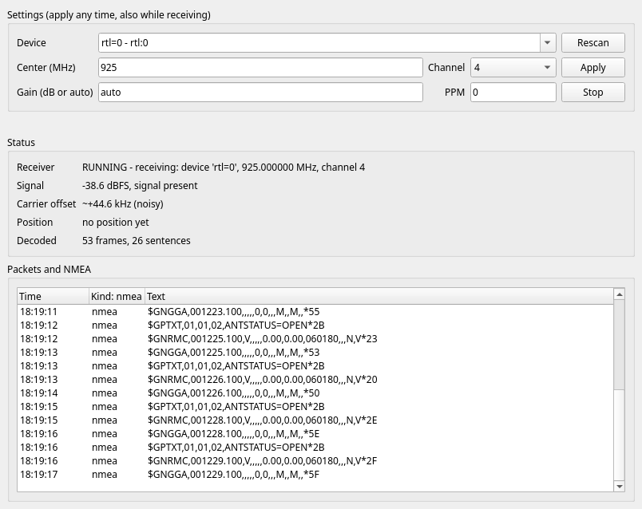

<div align="center">

# 🥚 Eggtimer Decoder

**Live decoder for Eggtimer / Eggfinder TX packets**
*Si1000 · 2-FSK · 9600 baud — from an RTL-SDR or a built-in simulated source*



</div>

---

## ✨ Overview

Eggtimer Decoder comes with a CLI and a small Qt (PySide6) GUI. You choose the device,
centre frequency (default 921 MHz) and channel 0-8. Each channel is a row of parameters plus
a frequency offset from the centre (see [`docs/CHANNELS.md`](docs/CHANNELS.md)).

## 📦 Install

Needs [mise](https://mise.jdx.dev). GNU Radio, gr-osmosdr and rtl-sdr are installed for you.
**Linux x86-64 only.**

```sh
git clone <repo> && cd eggtimer-decoder
mise trust
mise install
```

> [!NOTE]
> The first `mise run` below sets up the rest (a one-off download, so it takes a while).
> You may see a warning that post-link scripts were skipped; that is harmless.

## 🚀 Use

No SDR is needed to try it. Arguments for the decoder go after `--`:

```sh
mise run decode -- run --device sim --channel 3 --duration 5   # simulated source
mise run decode -- channels                                    # channel table
mise run decode -- devices                                     # attached SDRs ("none found" if empty)
mise run gui                                                   # open the GUI (needs a display)
```

Real SDR (receive only):

```sh
mise run decode -- run --device rtl=0 --center-freq 921M --channel 0 --gain 30
```

`run` is the default when only options are given. Useful options:

| Option | Purpose |
|---|---|
| `--ppm` | frequency correction |
| `--log-file PATH` | write JSON lines |
| `--position-file PATH` | write the last position |
| `-v`, `-q` | more / less output |

Ctrl-C stops. Frequencies accept `k`/`M`/`G` suffixes. `--help` works on every command.

**Exit codes:** `0` ok · `1` receiver error · `2` settings error

### ⚙️ Settings

Settings are saved between runs (the GUI uses the same file). Precedence, highest first:

1. command-line options
2. `EGGTIMER_*` environment variables (e.g. `EGGTIMER_CHANNEL=3`)
3. saved file
4. defaults

The file path can be moved with `EGGTIMER_CONFIG`.

```sh
mise run decode -- settings show
mise run decode -- settings set channel=3 center_freq_hz=921M gain=auto
mise run decode -- settings reset
```

### 🧰 Tasks

Run `mise tasks` to list them.

| Task | Does |
|---|---|
| `mise run decode -- [args]` | the CLI |
| `mise run gui` | open the GUI |
| `mise run sim` | simulated source, channel 0, 10 s |
| `mise run test` | test suite (hermetic, no SDR; GUI widget tests run offscreen) |
| `mise run hardware-test` | opt-in real RTL-SDR test; see [`docs/HARDWARE_TEST.md`](docs/HARDWARE_TEST.md) |

## 🔧 Extending

- **Add or fix a channel:** edit the `_DEFINED` list only; see [`docs/CHANNELS.md`](docs/CHANNELS.md).
- **Add a sink:** write a callable taking an event, dispatch on its type, ignore unknown types, and subscribe it
  to the receiver (see `sinks.py` and `cli._cmd_run`).
- **Add a source:** implement `SampleSource` (`read(n)` returns complex64, empty array = end; expose
  `sample_rate`), and give `LiveReceiver` a `source_factory` that returns it (see `sim_source.py`).
  Keep the source rate an integer multiple of the channel rate (192 kS/s).

## 📡 Signal

*Measured at ~920.99 MHz.*

```text
55 55 55 55 55 | 2D D4 | len | payload | CRC-16/XMODEM(len+payload)
```

Payloads are ≤32-byte chunks of the module's NMEA text stream, so one sentence spans several frames;
checksum-valid sentences are reassembled. Also seen: `!0>@0>=QUASAR>\r\n` and bare `\r\n` frames (passed through).
